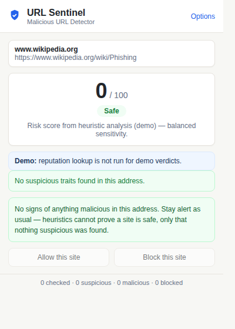
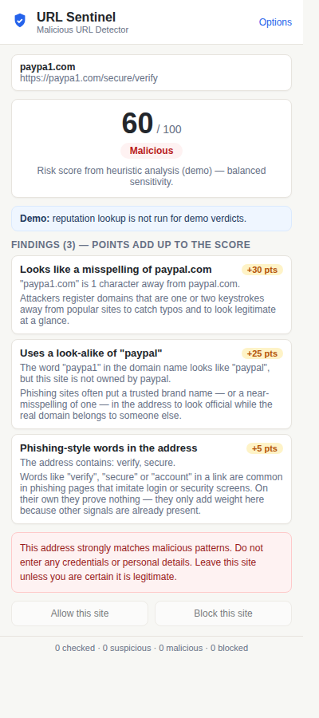
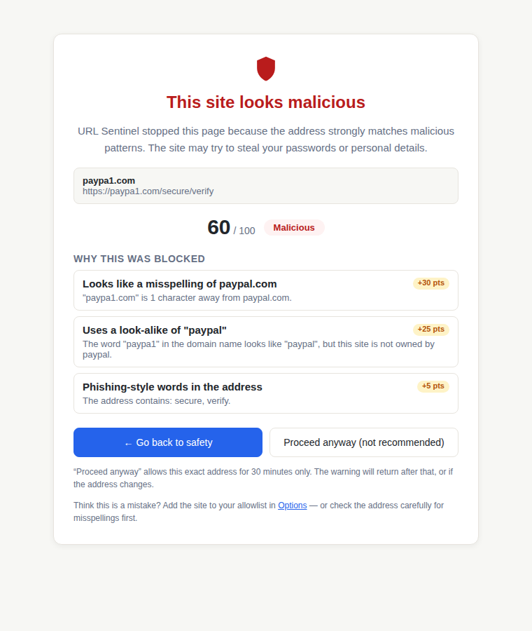
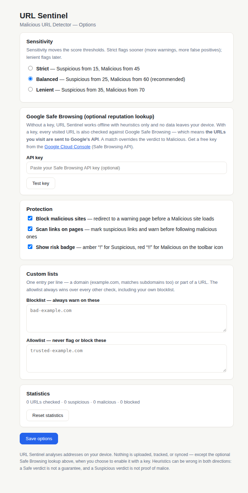

# URL Sentinel — Malicious URL Detector


A browser extension that detects malicious URLs in real time. Every site you visit is analysed **offline, on your device**, using a heuristic engine that scores the address 0–100 and explains each finding in plain language. Suspicious links on pages get a warning marker, and malicious sites are stopped with a warning page before they load. An optional Google Safe Browsing lookup adds reputation data when you provide an API key.

No build step, no backend, no account, no tracking.

| Popup — safe site | Popup — malicious site |
| --- | --- |
|  |  |
| Warning page | Options |
|  |  |

*Screenshots show the real extension running in Chromium. The popup shots use demo verdicts (`?demo=safe` / `?demo=malicious`).*

## Features

- **Real-time verdicts** — the background worker analyses every navigation and sets a badge on the toolbar icon: nothing when safe, amber `!` for Suspicious, red `!!` for Malicious.
- **Explainable risk score (0–100)** — every finding shows its points, so the score is a sum you can audit, not a black box.
- **Warning interstitial** — Malicious sites are redirected to a warning page listing exactly why, with "Go back to safety" and a "Proceed anyway" option (allows that exact address for 30 minutes only).
- **Link scanning** — a content script marks suspicious links on every page with a small warning marker and tooltip, and asks before following a malicious link.
- **Custom blocklist / allowlist** — your own lists, managed in Options. The allowlist always wins.
- **Sensitivity settings** — Strict / Balanced / Lenient move the score thresholds.
- **Statistics** — counts of URLs checked, suspicious, malicious, and blocked, stored locally.
- **Optional reputation** — Google Safe Browsing v4 lookup when you add an API key. A match overrides the verdict to Malicious. Without a key, the extension is heuristic-only and nothing leaves your device.

## How detection works

### Heuristic engine (`src/engine/`)

Fifteen checks, each producing its own finding with a plain-language explanation. Points add up to the 0–100 score.

| Check | Points | What it catches |
|---|---|---|
| Typosquatting (Levenshtein ≤ 2 of ~50 popular domains) | 30 | `gogle.com`, `paypa1.com` |
| `data:` URL as a navigation target | 30 | Fake pages embedded in the link itself |
| IP address as the host (public IPs only) | 25 | `http://185.220.101.5/login` |
| Brand impersonation (brand token in subdomain, domain, or path) | 25 | `paypal.secure-login.com` |
| `@` userinfo trick | 15 | `google.com@evil.com` |
| Punycode / IDN homograph (`xn--`) | 15 | Look-alike characters from other alphabets |
| Known URL shortener | 12 | `bit.ly`, `tinyurl.com`, … (hides the destination) |
| Open-redirect parameter pointing off-domain | 12 | `?url=https://evil.com` on a trusted site |
| Excessive subdomains (4+) | 10 | `paypal.com.login.verify.evil.com` |
| Commonly abused TLD | 10 | `.tk`, `.xyz`, `.top`, … |
| Non-standard port | 10 | `:8080`, `:8443` |
| Heavy percent-encoding | 8 | Obfuscated links |
| Hyphen- or digit-heavy domain | 8 | `secure-login-verify-account.com` |
| Suspicious keywords in path/query | 5 | `login`, `verify`, `secure`, … |
| Very long URL / host | 5 | Addresses designed to hide their tail |

**Fail-safe by design.** Unknown or ambiguous input resolves toward *not* flagging: private IPs and localhost are exempt from the IP check, unknown permissions of judgement (unknown domains, system-like hosts) are never flagged, and suspicious keywords only count when another signal is already present. The highest single finding is 30 points, so **no single signal can ever produce a Malicious verdict** — corroboration is always required (verified by test).

**Bands** (Balanced sensitivity): Safe 0–24 · Suspicious 25–59 · Malicious 60–100.
Strict moves them to 15 / 45; Lenient to 35 / 70.

### Reputation (optional)

With a Google Safe Browsing API key set in Options, each visited URL is also checked against Safe Browsing's `threatMatches` endpoint (threat types: malware, social engineering, unwanted software, potentially harmful applications). A match overrides the verdict to Malicious and adds a finding. Results are cached in memory for one hour. **Privacy note: when a key is set, the URLs you visit are sent to Google's API.** Without a key, no lookup happens and no data leaves the device. If a lookup fails, the extension falls back silently to heuristics.

URL Sentinel deliberately bundles **no list of "known bad" domains** — such lists go stale and can wrongly accuse a domain. Reputation comes from Safe Browsing; blocking of specific sites is yours to manage via the blocklist.

## Install (Load unpacked)

**Chrome / Edge (verified):**
1. Download or clone this repository.
2. Open `chrome://extensions/` (or `edge://extensions/`), enable **Developer mode**.
3. Click **Load unpacked** and select this folder.
4. Pin URL Sentinel to the toolbar. No build step — the extension runs from source.

**Firefox:** MV3 support exists but this extension has not been verified there yet. Load it via `about:debugging` → "This Firefox" → "Load Temporary Add-on" and select `manifest.json`.

**Try the demo verdicts:** open the popup pages directly from the extension to preview the UI without visiting a real malicious site:
- `chrome-extension://<id>/src/popup/popup.html?demo=safe`
- `chrome-extension://<id>/src/popup/popup.html?demo=malicious`

## Architecture

```
malicious-url-detector/
├── manifest.json                  Manifest V3, minimal permissions
├── icons/                         icon16/48/128.png
├── src/
│   ├── engine/                    Pure JS — no chrome.* imports, fully testable
│   │   ├── analyzer.js            The heuristic engine + scoring + bands
│   │   ├── data.js                Curated lists (shorteners, TLDs, ~50 popular
│   │   │                          domains, ~25 brands, keywords, redirect params)
│   │   ├── domains.js             Host parsing, registrable domains, IP checks
│   │   └── levenshtein.js         Edit distance for typosquatting
│   ├── lib/
│   │   ├── settings.js            Settings, lists, stats, temp allowlist
│   │   └── reputation.js          Google Safe Browsing v4 client
│   ├── background/
│   │   └── service-worker.js      Navigation analysis, badge, blocking,
│   │                              message hub for popup/content/warning
│   ├── popup/                     Verdict for the current tab (score, band,
│   │                              findings with points, advice, allow/block)
│   ├── options/                   Sensitivity, Safe Browsing key, toggles,
│   │                              blocklist/allowlist, statistics
│   ├── warning/                   Interstitial for blocked sites
│   └── content/                   Link scanning + markers + click warnings
└── tests/                         node:test suites (48 tests)
```

Data flow: navigation → service worker analyses with `analyzer.js` (plus Safe Browsing when a key is set) → badge set, stats counted, malicious URLs redirected to the warning page. The popup asks the worker for the current tab's analysis; the content script sends each page's links in one batch message and marks the results.

## Permissions — why each one is needed

| Permission | Why |
|---|---|
| `activeTab` | Read the current tab's URL for the popup verdict |
| `storage` | Settings, blocklist/allowlist, and stats on the device |
| `webNavigation` | Analyse navigations as they happen; redirect malicious ones |
| `tabs` | Redirect a tab to the warning page |
| `host_permissions: <all_urls>` | Analyse any site you visit and scan links on any page — the extension cannot judge a URL it cannot see |

## Privacy

- Heuristic analysis runs **entirely offline on your device**.
- No analytics, no tracking, no accounts, no data syncing.
- The only network call the extension ever makes is the optional Safe Browsing lookup, which happens only when you enter an API key — and then the checked URLs go to Google's API (stated in Options and here).
- Your blocklist, allowlist, settings, and statistics never leave the browser.

## Tests

```bash
npm test   # node:test, 48 tests — engine, domains, Levenshtein, reputation
```

The suites cover every heuristic check, scoring math, band boundaries at all three sensitivities, typosquat cases including near-misses that must *not* flag (e.g. `google.org`, `abc.com`), brand impersonation including look-alike words that must *not* flag (`pineapple.com`, `apply.example.com`), the "no single finding can be Malicious" property, and URL edge cases (malformed URLs, `chrome://` pages, localhost, private IPs). The engine is pure JS with no `chrome.*` imports, which is what makes this possible.

End-to-end verification was also done with the real extension loaded in Chromium (Playwright + Xvfb): popup, warning, and options pages rendered; a malicious navigation was redirected to the warning page; safe navigation loaded normally; the content script marked risky links correctly; zero service-worker errors.

## Limitations (honest)

- **Heuristics can be wrong in both directions.** A Safe verdict is not a guarantee, and a Suspicious verdict is not proof of malice — it is a risk assessment of the *address*, not the site's content.
- **No page-content inspection.** The extension judges URLs (and link targets), not what a page contains or does after it loads. A clean-looking URL can still lead to a malicious page — that is what the optional Safe Browsing lookup is for.
- **Registrable-domain extraction is approximate.** It uses a small list of common two-part suffixes (e.g. `co.uk`) rather than the full public suffix list, so unusual suffixes may be split one label too far. This only ever makes the typosquat check more conservative.
- **Shorteners and TLDs are weak signals.** Many legitimate sites use shorteners and uncommon TLDs; these checks only add weight alongside other signals.
- **Safe Browsing needs a key** (free from the Google Cloud Console) and sends visited URLs to Google when enabled.
- **Not a replacement for endpoint protection.** Use it alongside, not instead of, your browser's built-in protections and common sense.
- **Firefox is unverified** — the extension is developed and tested on Chromium/Chrome.

## License

MIT — see [LICENSE](LICENSE).
